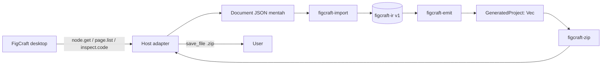
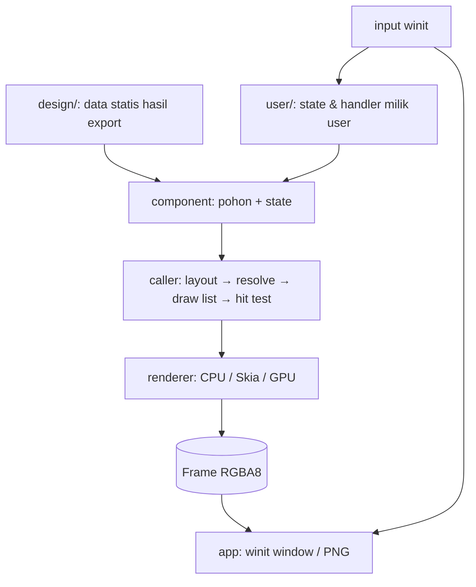

# Arsitektur FigCraft → Rust Export (v2)

> Status: **disetujui — Fase 0–7 selesai; verifikasi akhir berhasil.**
> Tujuan dokumen ini: menjadi kontrak arsitektur sebelum kode plugin dan project
> hasil export ditulis ulang. Setiap perubahan desain harus memperbarui dokumen ini
> lebih dulu. Bahasa Indonesia dipakai agar mudah didiskusikan.
>
> Keputusan yang sudah disetujui:
> 1. Backend dipilih saat **runtime** (`--backend`), dengan opsi build ringan.
> 2. Export ulang **tidak boleh** menimpa `src/user/`.
> 3. Widget v1 mencakup **semua widget yang didukung FigCraft** (lihat §5.5).
> 4. Pengerjaan dilakukan di repo `Brest`, project contoh di-regenerate dari sana.

---

## 1. Masalah arsitektur saat ini

| No | Masalah | Dampak nyata |
| --- | --- | --- |
| 1 | `figcraft-rust-export/src/lib.rs` melakukan semuanya: panel, traversal node, parsing JSON, codegen, ZIP, `save_file`. | Sulit diuji, sulit diganti satu bagian, dan perubahan kecil berisiko merusak yang lain. |
| 2 | IR di `model.rs` tidak punya nomor versi dan masih menebak kunci JSON (`absoluteBounds`, `textAlign`, dll). | Saat skema FigCraft berubah, plugin diam-diam menghasilkan UI yang salah. |
| 3 | Tidak ada tahap normalisasi koordinat. Node bertanda absolut, tapi `caller` menjumlahkannya dengan offset orang tua berulang kali. | Layout anak tidak bisa diprediksi, terutama pada auto-layout. |
| 4 | Backend dipilih dengan `#[cfg(feature = "skia")]` yang menimpa `cpu`/`gpu`, lalu struktur `Frame` dan `&mut R` ditambahkan sebagai tambalan. | Sulit dipakai, sulit diuji, dan API membocorkan detail implementasi. |
| 5 | `Caller` memiliki renderer; aplikasi window harus meminjam renderer lewat trampolin `&mut R`. | Ketergantungan berputar dan tidak ada siklus hidup renderer yang jelas. |
| 6 | Template `.txt` dan string codegen hidup berdampingan. | Generated project hanya diverifikasi manual lewat contoh; tidak ada jaminan semua kombinasi valid. |
| 7 | Tidak ada model state/event/binding. Teks `{{key}}` hanya di-resolve sekali saat menggambar. | Hasil export adalah gambar statis, bukan aplikasi UI yang bisa interaktif. |
| 8 | Tidak ada pemisahan file generated dan file milik user. | Export ulang akan menimpa kustomisasi pengguna. |
| 9 | Error bertipe `String` di semua lapis. | Tidak bisa dibedakan antara error import, emit, render, dan host. |
| 10 | Aset gambar hanya berupa path. | Project hasil export bisa kehilangan gambar saat dipindah. |

Prinsip perbaikan: **lebih sedikit trik, lebih banyak kontrak yang jelas.**

---

## 2. Prinsip desain

1. **Pipeline satu arah, tiap tahap murni dan bisa diuji sendiri.**
   Tidak ada tahap yang memanggil mundur ke tahap sebelumnya.
2. **Data dulu, perilaku kemudian.**
   FigCraft menghasilkan *data desain*; logger/app yang menentukan perilaku runtime.
3. **Satu bahasa primitives untuk semua lapis.**
   `Rect`, `Size`, `Color`, `DrawList` didefinisikan sekali di lapis paling dasar.
4. **Backend adalah implementasi, bukan struktur program.**
   Program tidak berubah saat backend diganti.
5. **Generated code tidak boleh perlu diedit agar bisa dipakai.**
   Kustomisasi pengguna ditempatkan di folder terpisah yang tidak pernah ditimpa.
6. **Semua batas punya tipe error sendiri.**
   `ImportError`, `EmitError`, `ExportError`, `RenderError`, `AppError`.
7. **Versi eksplisit.**
   IR dan generator punya nomor versi yang ditulis ke project hasil export.
8. **Uji dengan fixture nyata, bukan hanya contoh buatan.**

---

## 3. Peta arsitektur keseluruhan



Di dalam project Rust hasil export:



Ketergantungan modul (panah = “bergantung pada”, tidak boleh ada siklus):

```
core  ←  component  ←  caller  ←  app
 ↑           ↑            ↑
 └────── renderer ────────┘
```

`core` adalah daun; `renderer` tidak boleh mengimpor `component` atau `caller`.

---

## 4. Arsitektur sisi plugin

### 4.1 Pemisahan crate

```
/
├─ Cargo.toml                    # workspace
├─ crates/
│  ├─ figcraft-plugin-sdk/       # vendored, tidak diubah
│  ├─ figcraft-ir/               # tipe IR v1 + schema versi
│  ├─ figcraft-import/           # JSON FigCraft -> IR + normalisasi
│  ├─ figcraft-emit/             # IR -> GeneratedProject (template typed)
│  ├─ figcraft-zip/              # ZIP deterministik + guard ukuran
│  └─ figcraft-plugin/           # HANYA adapter host (WASM cdylib)
├─ templates/                    # source of truth project hasil export
│  ├─ Cargo.toml.rs
│  ├─ src/main.rs
│  ├─ src/app.rs
│  ├─ src/component/*.rs
│  ├─ src/caller/*.rs
│  ├─ src/renderer/*.rs
│  └─ src/design/mod.rs.rs       # placeholder untuk data hasil export
├─ fixtures/                     # payload FigCraft asli untuk golden test
├─ tests/golden/                 # snapshot project hasil export
├─ docs/ARSITEKTUR.md
└─ scripts/build.ps1
```

`figcraft-plugin` tetap menjadi satu-satunya `cdylib` untuk `wasm32-unknown-unknown`.
Crate lain adalah `rlib` biasa sehingga bisa di-test di host tanpa WASM.

### 4.2 Kontrak tiap crate

**`figcraft-ir`**

```rust
pub const IR_VERSION: u16 = 1;

pub struct Design {
    pub version: u16,
    pub generator: String,
    pub name: String,
    pub size: Size,
    pub nodes: Vec<Node>,          // sudah lokal & ternormalisasi
    pub assets: Vec<Asset>,        // bytes + mime + nama file
    pub warnings: Vec<Warning>,    // fitur yang tidak didukung
    pub source: SourceInfo,        // halaman, selection, timestamp export
}

pub struct Node {
    pub id: NodeId,
    pub name: String,
    pub rect: Rect,                // SELALU relatif terhadap induk
    pub style: Style,
    pub kind: Kind,
    pub visible: bool,
    pub children: Vec<Node>,
}

pub enum Kind {
    Frame(FrameSpec),              // layout: None | Horizontal | Vertical
    Shape(ShapeSpec),              // rect, ellipse, line, path
    Text(TextSpec),                // text, font, size, align, binding
    Image(AssetId),
    Widget(WidgetSpec),            // Button | TextInput | Checkbox | ...
}
```

**`figcraft-import`**

```rust
pub fn parse_document(raw: &str) -> Result<Document, ImportError>;
pub fn normalize(doc: &Document, ctx: &ImportContext) -> Result<Design, ImportError>;
```

Tahap normalisasi yang wajib:

1. Ubah `absoluteBounds` menjadi rect relatif induk.
2. Terapkan transform rotasi/skala bila ada; jika tidak bisa, catat `Warning`.
3. Satukan `fills`/`strokes` menjadi `Style` yang kanonik (warna + opacity + radius).
4. Ubah `textAlign`/`textAlignHorizontal` menjadi satu enum `Align`.
5. Kumpulkan aset gambar ke `Vec<Asset>`; jangan simpan path mentah.
6. Simpan `{{key}}` sebagai `Binding`, bukan string biasa.
7. Batasi jumlah node, kedalaman, dan total byte aset.

**`figcraft-emit`**

```rust
pub struct EmitOptions {
    pub crate_name: String,
    pub default_backend: Backend,
    pub include_reference_css: bool,
}

pub struct GeneratedProject {
    pub files: Vec<GeneratedFile>, // path relatIF + bytes
    pub manifest: ProjectManifest, // versi generator & IR
}

pub fn emit(design: &Design, options: &EmitOptions) -> Result<GeneratedProject, EmitError>;
```

Aturan: semua file berasal dari template typed yang di-`include_str!` dan
divalidasi oleh golden test. Tidak ada lagi `format!` besar di dalam `lib.rs`.

**`figcraft-plugin` (adapter host)**

Tugasnya hanya:

1. Baca argumen command/panel (satu struct `ExportOptions`).
2. Ambil selection atau halaman aktif (`page.list` → `node.get`, rekursif).
3. Ambil `inspect.code` opsional sebagai referensi CSS.
4. Panggil `figcraft_import` → `figcraft_emit` → `figcraft_zip`.
5. `save_file("<crate>.zip", "application/zip", bytes)`.

Tidak ada logika layout, warna, atau codegen di crate ini.

### 4.3 Manifest & batas host

Tetap API `4`, permission `read` + `saveFile`, allowlist:
`node.get`, `page.list`, `inspect.designContext`, `inspect.code`.

Guard yang dikonfigurasi di satu tempat:

| Batas | Nilai |
| --- | --- |
| Node | 2.000 |
| Kedalaman | 24 |
| Host call | < 100.000 |
| Memori WASM | < 64 MB |
| ZIP sebelum `save_file` | < 16 MB |

Jika guard terlanggar, plugin menampilkan pesan jelas di panel **sebelum**
`save_file`, bukan error diam-diam.

---

## 5. Arsitektur project hasil export

### 5.1 Struktur folder

```
<crate>/
├─ Cargo.toml
├─ README.md                     # cara pakai + nomor versi generator
├─ GENERATED.md                  # daftar file yang akan ditimpa saat export ulang
├─ assets/                       # gambar hasil export (disalin, bukan path absolut)
├─ src/
│  ├─ main.rs                    # 8 baris: parse CLI → App::new → run
│  ├─ app.rs                     # shell winit, event, redraw, shortcut
│  ├─ core.rs                    # Rect/Size/Point/Color/DrawList (daun)
│  ├─ component/
│  │  ├─ mod.rs                  # Node, Style, Kind, Component
│  │  ├─ tree.rs                 # walk, find, hit-test helper
│  │  └─ state.rs                # Value, Binding, State, Event
│  ├─ caller/
│  │  ├─ mod.rs                  # facade: layout(), draw_list(), render()
│  │  ├─ layout.rs               # solver absolut + auto layout + padding/gap
│  │  └─ resolve.rs              # binding, teks, warna, visibility
│  ├─ renderer/
│  │  ├─ mod.rs                  # Backend, Renderer, Frame, create()
│  │  ├─ cpu.rs
│  │  ├─ skia.rs
│  │  ├─ gpu.rs
│  │  └─ png.rs                  # encoder RGBA8 -> PNG
│  ├─ design/
│  │  └─ mod.rs                  # @generated: data statis hasil export
│  └─ user/
│     ├─ mod.rs                  # milik user, TIDAK pernah ditimpa
│     └─ handlers.rs             # contoh handler event (bisa diedit)
└─ tests/
   ├─ layout.rs                  # golden layout
   └─ render.rs                  # golden pixel/hash
```

Tiga modul yang diminta spesifikasi tetap ada dan tetap bernama:

| Spesifikasi | Modul Rust | Peran |
| --- | --- | --- |
| `komponen` | `component` | Data UI + state + event. Tidak tahu cara menggambar. |
| `pemanggil` | `caller` | Layout, resolusi nilai, hit-test, susun `DrawList`. |
| `penggambar` | `renderer` | Terima `DrawList`, hasilkan `Frame`. |

`core`, `app`, `design`, dan `user` adalah pendukung, bukan modul domain ke-4.

### 5.2 Kontrak publik (yang dipakai `main.rs`)

```rust
// core.rs — daun, tanpa dependency
pub struct Point { pub x: f32, pub y: f32 }
pub struct Size { pub width: f32, pub height: f32 }
pub struct Rect { pub origin: Point, pub size: Size }
pub struct Color { pub r: u8, pub g: u8, pub b: u8, pub a: u8 }
pub struct Frame { pub size: Size, pub pixels: Vec<u8> } // RGBA8, unpremultiplied

// component
pub struct Component { pub name: String, pub design_size: Size, pub root: Vec<Node> }
pub struct State { /* values, hover, focus, checked, text input */ }
pub enum Event { PointerDown(NodeId), PointerUp(NodeId), Key(String), TextInput(NodeId, String) }

// caller
pub struct Caller;
impl Caller {
    pub fn layout(component: &Component, state: &State, viewport: Size) -> Layout;
    pub fn draw_list(component: &Component, layout: &Layout, state: &State) -> DrawList;
    pub fn hit_test(layout: &Layout, point: Point) -> Option<NodeId>;
    pub fn render(
        &self,
        renderer: &mut dyn Renderer,
        component: &Component,
        state: &State,
        viewport: Size,
    ) -> Result<Frame, RenderError>;
}

// renderer
#[derive(Clone, Copy)] pub enum Backend { Cpu, Skia, Gpu }
pub enum DrawCmd { Rect, RoundedRect, Ellipse, Line, Text, Image, Clip, PopClip }
pub struct DrawList { pub commands: Vec<DrawCmd> }
pub trait Renderer {
    fn kind(&self) -> Backend;
    fn render(&mut self, list: &DrawList, size: Size) -> Result<Frame, RenderError>;
}
pub fn create(backend: Backend) -> Result<Box<dyn Renderer>, RenderError>;

// app
pub struct App { /* component, state, renderer, window */ }
impl App {
    pub fn new(component: Component, backend: Backend) -> Result<Self, AppError>;
    pub fn run(self) -> Result<(), AppError>;
}
```

`main.rs` yang dihasilkan menjadi sesederhana ini:

```rust
fn main() -> Result<(), AppError> {
    let design = design::build();
    let backend = Backend::from_args_or_default()?;
    app::App::new(design, backend)?.run()
}
```

### 5.3 Alur satu frame

1. `app` menerima event winit (resize, pointer, keyboard).
2. Event diteruskan ke `user::handlers`, lalu ke `State`.
3. `Caller::layout` menghitung posisi absolut dari pohon + state (hover/focus boleh mengubah style).
4. `Caller::draw_list` mengubah node + layout + state menjadi `DrawList` murni.
5. `Renderer::render` menghasilkan `Frame` RGBA8.
6. `app` menampilkan `Frame` (window via softbuffer, atau `--png` via `png::encode`).
7. `R` = redraw paksa, `S` = simpan PNG, `Esc` = keluar.

Tidak ada encoder PNG di dalam backend. Backend hanya mengembalikan piksel.

### 5.4 Backend & fitur Cargo

| Mode | Fitur | Perilaku |
| --- | --- | --- |
| Default | `cpu,skia,gpu,ui` | Ketiga backend tercompile, dipilih saat runtime: `--backend cpu\|skia\|gpu`. |
| Ringan | `cpu,ui` | Tanpa Skia/wgpu, untuk CI & mesin tanpa GPU. |
| Tanpa window | `(backend saja)` | Binary hanya `--png`, cocok untuk server. |

Aturan: `Backend` selalu ada sebagai enum; kalau sebuah backend tidak dikompilasi,
`create()` mengembalikan error yang jelas, bukan `cfg` yang menghilangkan kode.

### 5.5 State, binding, dan widget

- Setiap teks/image/widget punya `Binding` opsional (`{{key}}` dari FigCraft).
- `State::set("key", Value::Text("..."))` mengubah tampilan frame berikutnya.
- `NodeId` dipakai untuk hit-test, hover, fokus, dan event.
- Widget v1 mencakup **semua kind yang dikenal `figcraft-ir`**: `Button`, `TextInput`,
  `TextArea`, `Checkbox`, `RadioButton`, `Switch`, `Slider`, `ProgressBar`, `Dropdown`,
  `ListBox`, `Menu`, `MenuItem`, `Tabs`, `TabItem`, `Tooltip`, `Modal`, `Accordion`,
  dan `Custom(name)`. `caller` memiliki jalur gambar untuk masing-masing kind;
  nama yang tidak dikenal tetap dibawa sebagai `Custom` plus `Warning` dari importer.
- Handler milik user ada di `src/user/handlers.rs`; file ini tidak pernah ditimpa.
  ZIP juga membawa `sync.ps1`, yang menyalin file generated sambil melewati
  `src/user/**`.

### 5.6 Aset & font

- Gambar yang dikirim host sebagai byte array disimpan di `Component.assets` dan
  ditulis sebagai literal byte di `src/design/mod.rs` ( IR v1). Tidak ada path
  sistem file di IR, sehingga project tetap portabel. `inspect.code` hanya dipakai
  sebagai referensi CSS opsional, bukan sumber aset.
- Teks memakai font bitmap bawaan untuk v1; `renderer::font::rasterize`/`measure`
  dipakai bersama oleh CPU, Skia, dan GPU supaya hasilnya identik.
- Jika FigCraft memakai font kustom, simpan metadata sebagai `Warning` (bukan error diam).

### 5.7 Error

| Lapisan | Tipe | Contoh |
| --- | --- | --- |
| Plugin | `ImportError`, `EmitError`, `ExportError` | skema tidak dikenal, ZIP > 16 MB |
| Generated | `RenderError`, `AppError` | GPU tidak tersedia, window gagal dibuat |

Semua tipe implements `Display` + `std::error::Error`. Tidak ada `String` sebagai
satu-satunya error di API publik.

---

## 6. Strategi pengujian

| Lapisan | Pengujian |
| --- | --- |
| `figcraft-import` | Unit test per normalisasi + fixture payload FigCraft asli di `fixtures/`. |
| `figcraft-ir` | Serde round-trip; migrasi versi ditolak dengan jelas. |
| `figcraft-emit` | Test determinisme + struktur file (`Cargo.toml`, tiga modul domain, `user/`, `sync.ps1`). |
| `figcraft-zip` | CRC-32 known-answer, determinisme urutan file, batas 16 MB. |
| Generated `layout` | Test absolut, relatif induk, auto-layout (gap + padding), dan hit-test. |
| Generated `renderer` | Test frame CPU, PNG signature/IHDR, dan parsing backend. |
| Generated `app` | `cargo run -- --frames 3` exit 0 di CPU/Skia/GPU; `--png` menulis file. |
| Plugin WASM | `wasm32-unknown-unknown` build; export hanya `figcraft_run`; import hanya modul `figcraft`. |
| End-to-end | Import plugin di FigCraft → jalankan `Export to Rust` → ZIP → build → jalankan. |

Satu skrip `scripts/verify.ps1` menjalankan semuanya dan dipakai sebagai definisi
“selesai”.

---

## 7. Rencana migrasi (bertahap, tiap langkah bisa di-review)

| Fase | Perubahan | Keluarannya |
| --- | --- | --- |
| 0 | Dokumen ini disetujui | Kesepakatan arsitektur |
| 1 | Buat `figcraft-ir` + `figcraft-import` + fixture | IR v1, parser teruji |
| 2 | Buat `figcraft-emit` + template typed + golden test | Generated project v2 valid |
| 3 | Tulis ulang `component` + `caller` (layout/resolve) | UI deterministik & teruji |
| 4 | Tulis ulang `renderer` (DrawList, runtime backend) | CPU/Skia/GPU konsisten |
| 5 | Tulis `app` (winit + input + state + `--png`) | Aplikasi UI sungguhan |
| 6 | Kurangi `figcraft-plugin` jadi adapter host | Plugin rapi & pesan error jelas |
| 7 | Hapus kode lama, perbarui README/build script | Rilis v2 bersih |

Eksperimen winit yang saya tambahkan di `C:\Users\culov\Documents\figcraft_design`
**tidak dijadikan dasar**; ia hanya bukti konsep bahwa pipeline saat ini bisa
ditampilkan di window. Implementasi v2 akan menulis ulang bagian itu mengikuti
desain di atas.

---

## 8. Kriteria “matang” (definition of done)

- [x] `cargo test --workspace` hijau, termasuk `cargo clippy --workspace --all-targets -- -D warnings`.
- [x] Generated project lolos `cargo check` untuk CPU, Skia, GPU, default, dan tanpa window.
- [x] `cargo run -- --backend <cpu|skia|gpu> --frames 3` exit 0; `--png` menghasilkan PNG.
- [x] Export ulang aman: `sync.ps1` melewati `src/user/**`, dan manifest ZIP menandai owner tiap file.
- [x] Error memakai tipe berlapis (`ImportError`, `EmitError`, `ZipError`, `RenderError`, `AppError`); adapter host menerjemahkannya ke pesan SDK.
- [ ] Plugin muncul di Actions FigCraft (`Ctrl+K`) dan `save_file` menghasilkan ZIP — perlu uji manual di aplikasi FigCraft.
- [x] ZIP plugin berisi `figcraft-plugin.json` + WASM yang valid.
- [x] README menjelaskan arsitektur, cara pakai, dan batasan v1.

---

## 9. Keputusan yang sudah dikonfirmasi

1. **Pemilihan backend:** runtime switch (`--backend cpu|skia|gpu`) + opsi build ringan. ✅
2. **Export ulang:** aman; `src/user/**` tidak pernah ditimpa oleh `sync.ps1`. ✅
3. **Widget interaktif di v1:** semua widget yang dikenal FigCraft/IR, bukan hanya tiga dasar. ✅
4. **Nama modul:** `component/caller/renderer` di kode, alias Indonesia di dokumentasi. ✅
5. **Lingkup repositori:** perbaikan di `C:\Users\culov\Documents\Project\Brest`; project lama
   hanya bukti konsep dan tidak dipakai sebagai dasar v2. ✅
